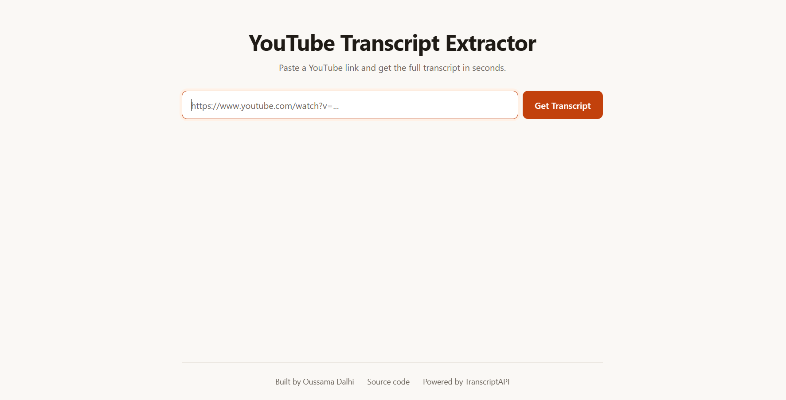

# YouTube Transcript Extractor

**Live demo:** https://youtube-transcript-extractor.fastapicloud.dev/

A small full-stack web app that turns a YouTube link into a copyable transcript. Built with FastAPI and plain HTML, CSS and JavaScript.

[](https://youtube-transcript-extractor.fastapicloud.dev/)


## Features

- Paste a YouTube link and get the full transcript in seconds
- English, German and Arabic transcripts, including auto-generated captions
- One-click copy to clipboard
- 24-hour in-memory cache, so repeated videos cost nothing
- Per-IP rate limiting (10 requests per minute)
- Clear error messages for invalid links, missing transcripts and busy servers
- Responsive design that works well on phones

## Tech Stack

FastAPI, Pydantic, requests, cachetools, slowapi, vanilla JavaScript, and [TranscriptAPI](https://transcriptapi.com/) for fetching transcripts.

## Why These Choices

- **FastAPI:** a small, modern framework that fits a single-endpoint JSON API well. Pydantic validates requests from plain type hints, error handling stays simple, and interactive API docs are generated automatically at `/docs`.
- **TranscriptAPI:** handles transcript retrieval when direct YouTube access is unreliable, since YouTube blocks requests from datacenter IPs.
- **In-memory cache:** reduces repeated external API requests, which saves credits and makes repeat lookups instant.
- **SlowAPI:** limits request frequency so one visitor can't use up the API credits.
- **Vanilla JavaScript:** keeps the frontend lightweight, with no build step or framework needed for a single-page tool.

## How It Works

1. The browser sends `POST /transcript` with the YouTube URL.
2. FastAPI validates the input and checks the cache.
3. On a cache miss, the backend requests the transcript from TranscriptAPI.
4. The segments are joined into one string, cached, and returned as JSON.

## Getting Started

```bash
git clone https://github.com/oussama-dalhi/youtube-transcript-extractor.git
cd youtube-transcript-extractor
python -m venv .venv
source .venv/bin/activate   # Git Bash: source .venv/Scripts/activate | Windows CMD: .venv\Scripts\activate.bat
pip install -r requirements.txt
```

Copy the example environment file and add your API key (new TranscriptAPI accounts get 100 free credits):

```bash
cp .env.example .env
```

Then edit `.env`:

```
TRANSCRIPT_API_KEY=your_key_here
```

Start the server:

```bash
python -m uvicorn app.main:app --reload
```

Open http://127.0.0.1:8000. Interactive API docs are at http://127.0.0.1:8000/docs.

## API

`POST /transcript`

```json
{ "url": "https://www.youtube.com/watch?v=dQw4w9WgXcQ" }
```

Success:

```json
{ "video_url": "https://www.youtube.com/watch?v=dQw4w9WgXcQ", "transcript": "..." }
```

Errors always use the same shape, with a matching status code (404 no transcript, 422 invalid link, 429 too many requests, 503 service problem):

```json
{ "detail": "No transcript found." }
```
## Deployment

The app is deployed on [FastAPI Cloud](https://fastapicloud.com/).

- Dependencies must be listed in `pyproject.toml`, which is what FastAPI Cloud installs from. `requirements.txt` is only for local setup, so keep the two in sync.
- Set `TRANSCRIPT_API_KEY` as a secret: `fastapi cloud env set --secret TRANSCRIPT_API_KEY "your-key"`
- Deploy with `fastapi login` and then `fastapi deploy`.
-Or just link your github repo with fastapicloud

## Problems I Solved

| Problem | Solution |
|---|---|
| YouTube blocks datacenter IPs, so the `youtube-transcript-api` library worked locally but failed once deployed (`IpBlocked`) | Switched to the hosted TranscriptAPI, which handles access to YouTube |
| Every request costs an API credit | Added a 24-hour TTL cache and a rate limit per-IP |
| Errors were inconsistent across the backend | A custom `TranscriptError` with a status code and one exception handler, so every error returns `{"detail": ...}` |
| FastAPI validation errors come back as lists, not strings | Pydantic trims and length-checks the URL, and the frontend maps 422 to a friendly message |
| Errors showed up inside the transcript box, and Copy copied them | Separate status line; the result box stays hidden until there is a real transcript |
| The button stayed disabled after an error response | `try/catch/finally` so it is always re-enabled |
| Long transcripts were a hard-to-read wall of monospace text | Proportional font, generous line height, scrollable result box |
| Layout broke down on small screens | Media queries for a full-width button and stacked footer links |

## Known Limitations

- Needs a TranscriptAPI key, and usage is limited by your credits.
- The cache and rate-limit counters live in memory, so they reset on restart and are not shared between multiple instances.

## Ideas for Improvement

- Download the transcript as a TXT file
- Video title and thumbnail
- AI summary of the transcript


## Project Structure

```
youtube-transcript-extractor/
├── app/
│   ├── assets/showcase.png
│   ├── static/
│   │   ├── css/style.css
│   │   └── js/script.js
│   ├── templates/index.html
│   ├── main.py
│   └── transcript.py
├── pyproject.toml
├── requirements.txt
└── README.md
```

Built for fun and education.
